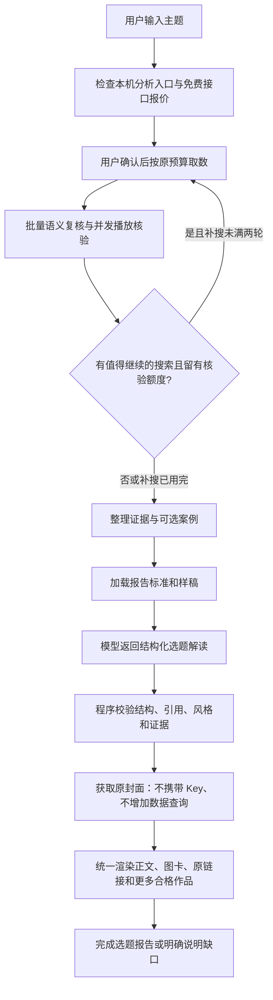

# 报告生成流程

## 已确认的交付

以 references/report-standard.md 为交付约束，以 references/report-example.json 为口语样稿。先完成本地实现与验收；GitHub 同步和网站发布按当前任务的明确授权分别执行，不能假设三处自动一致。用户通过 GitHub 链接把仓库交给自己的 Agent 使用，不设计独立安装包。

## 本轮实现边界

- 不改付费上限、身份验证、密钥存储、分析账户选择和部署。
- 新交付格式与旧研究格式并存；旧缓存通过离线重写报告接入新格式。
- 写作、渲染和离线修复不允许新增 TikHub 查询；封面为独立的公开媒体请求。
- 新格式按已选案例交付选题分析，正文证据缺失不会自动阻塞这种解读，也不授权编造视频细节。
- 先复用本轮 Skill 的缓存制作真实成品，再用合成的不同主题检查结构和口吻是否固化。

## 本地验收

报告可用与研究目标完成分开。沿用原独立检查器，从搜索/作者/播放缓存和请求账本复算完成依据；已有稿可读但目标未全部达成时使用 `report_ready`，缺数据时不反复调用写作。数量例外只绑定获授权的那一轮。字段定义和反例见 `completion-verification.md`。

1. 标准与示例确实进入分析提示，三种现有 CLI 协议获得同一结构要求。
2. 没有正文时完成有依据的选题解读；伪造视频开场/未知引用/修改统计被拒绝。
3. 未核验条目保留且不升级；无案例和请求中断明确区分。
4. 原封面成功时内嵌，失败时保留可读结果和原视频入口。
5. 数据和链接从原记录生成，所有用户标签使用账号正常播放量。
6. 离线重写前后请求账本一致；完成状态能在网页刷新。
7. 桌面、手机查看和打印可用；无 HTML 注入或越界文件读写。
8. 独立审查后修复阻塞问题。跨电脑真实验收和新主题付费试跑另行安排，不把本机模拟称为已通过。

## 当前并发与停止策略

- 准备分析时同时规划1–3个首轮搜索词，不额外增加一个模型调用。
- 已知关键词第一页并发获取；每个关键词自己的翻页顺序保留。
- 语义复核以批次完成，再核验该批小号；不同作者的历史请求并发，同一作者翻页依序且缓存共用。
- 后续批次只审核新增、条件/内容/证据变化或上次不确定的条目，旧判断由程序合并。审核指纹与播放核验指纹分别检查，不能用其中一个代替另一个。
- 已核验作品在当前进度页逐批显示，可先打开原视频；写作和后续研究继续进行。完成后仍直接进入最终报告，不增加完成后的中间页。
- 最终报告保存后由独立检查器重新读取数据、重新计算已核验终态、核对完整HTML。未通过时不发布完成状态。交付安装更新另跑完整浏览器入口，见 `delivery-verification.md`。
- 统计接口保持每次最多2条，独立批次并发。所有状态由调用线程合并；预算预留、缓存去重和账本写入受保护。
- 正文精选至多3条；总结果池不以3条为停止条件。先核验已有相关小号，最多补搜两轮，每轮最多2个查询，仍受原50次请求与0.50美元预留额度约束。
- 每个关键词最多3页。上一页确实新增了相关、已达到观察天数的小号时，优先保留该词翻页；同时可尝试一个新的同主题用途词。全是大号、全是重复或已经出错的词不自动继续翻页。
- 补搜前为后续作者历史与播放查询留出额度；默认按3页作者历史和6次播放请求估计核验空间，余额较少时可提前结束而不强行花满。
- 默认候选核验上限从8提高到50。过新、无作者或超过粉丝限制的作品先处理，不占可查询候选位；已完成且身份、日期、粉丝与统计未变的结果复用。
- 作者历史每批最多预取3条候选涉及的作者，查完本批播放后再取下一批；剩余额度较少时缩小批次，避免先查大量作者而没有额度核验播放。
- 每接口默认0.5秒发起一次、最多3个在途请求；429暂停后续同接口请求，不自动重试刚才的收费请求。
- 认证或本地保存失败停止尚未发送的队列；已经发出的请求仍记录并保留预留。
- 当前AI相关性复核按批次执行，没有对同一条作品抢先收费核验，也没有启动每条视频一个模型任务。

## 2026-10-11 阅读界面调整

正式选题报告从主题标题直接进入正文分析。合格/精选/方法数量、结果池目标、章节目录、粉丝与播放分档开场、通用依据声明、预算与内部数据附录不再显示。作品卡片的真实数值、原作品链接和可展开对照保留；部分完成与无案例的真实提示保留。原始记录、模型稿件、审核凭据、数量目标和费用检查均保留，这次只调整渲染，不改写作提示或重新调用模型。
